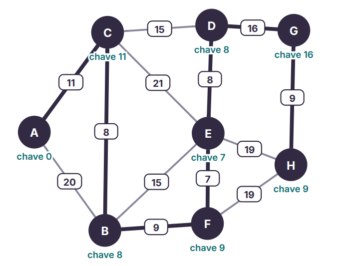

Etapa 1 -

1.

RA - 019051

D1 - 0

D2 - 1

D3 - 9

D4 - 0 

D5 - 5 

D6 - 1

Destino - S6

e1 = 11

e2 = 20

e3 = 8

e4 = 15

e5 = 15

e6 = 9

e7 = 8

e8 = 16

e9 = 7

e10 = 19

e11= 19

e12 = 9

e13 = 21

2.

3.

4. Cada corredor aparece duas vezes, portanto, 2x13 arestas = 26 células preenchidas. Das 64 células, 38 são nulas.

Etapa 2 - 

Etapa 3 - 

Para essa etapa tive bastante dificuldade, a forma que encontrei para desenvolver o que consegui foi através da documentação, mais especificamente o que contem em "https://networkx.org/documentation/latest/reference/algorithms/shortest_paths/dijkstra.html"

Etapa 4 - 

1- A distância mínima é de 42km. O caminho é: S0 -> S1 -> S3 -> S6. O S0 é fechado na primeira iteração. O S1 é fechado logo em seguida na segunda. O S3 vai ser fechado só na iteração 4. S7 é fechado na iteração 7.

2- Com a queda do ramal e5 = (S2,S4) a melhor rota não muda, tendo em vista de que o melhor caminho não passa por ela, não tendo custo ou acréscimo em km ou percentual.

3- O custo total da Árvore Geradora Mínima que conecta todas as estações com menor custo é 11 + 8 + 9 + 7 + 8 + 16 + 9 = 68. 

Comparando com a rota gerada pelo Dijkstra, é significativamente maior (68 - 42 = 26). O caminho gerado pelo Dijkstra não resulta na MST pois, diferente do Prim, esse algoritmo não busca conectar todos os vértices, apenas buscar o caminho mais curto entre a origem e o destino.
