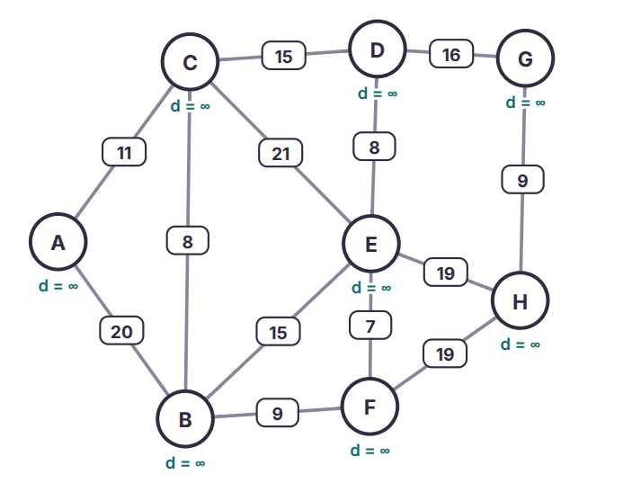
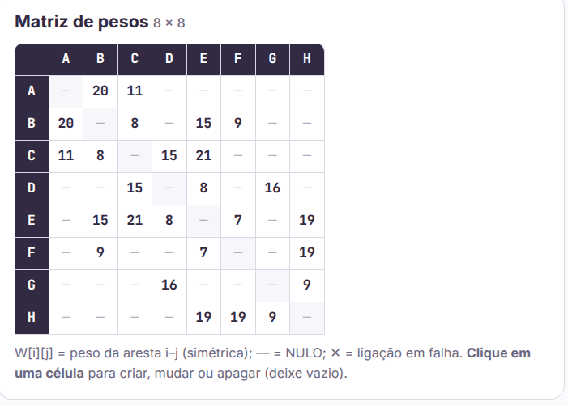
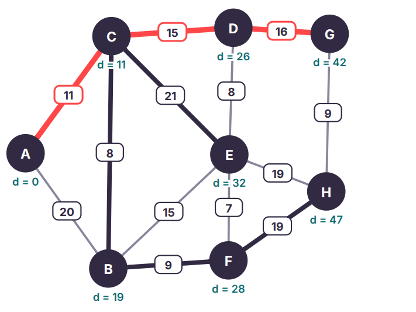
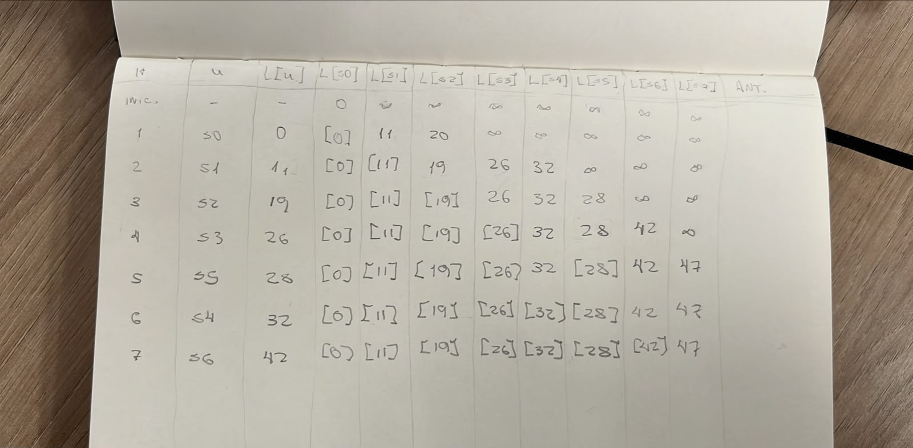

Etapa 1 -
1.
RA - 019051

D1 - 0
D2 - 1
D3 - 9
D4 - 0 
D5 - 5 
D6 - 1

Destino - S6

e1 = 11
e2 = 20
e3 = 8
e4 = 15
e5 = 15
e6 = 9
e7 = 8
e8 = 16
e9 = 7
e10 = 19
e11= 19
e12 = 9
e13 = 21

2.

3.

4. Cada corredor aparece duas vezes, portanto, 2x13 arestas = 26 células preenchidas. Das 64 células, 38 são nulas.

Etapa 2 - 

Etapa 3 - 

